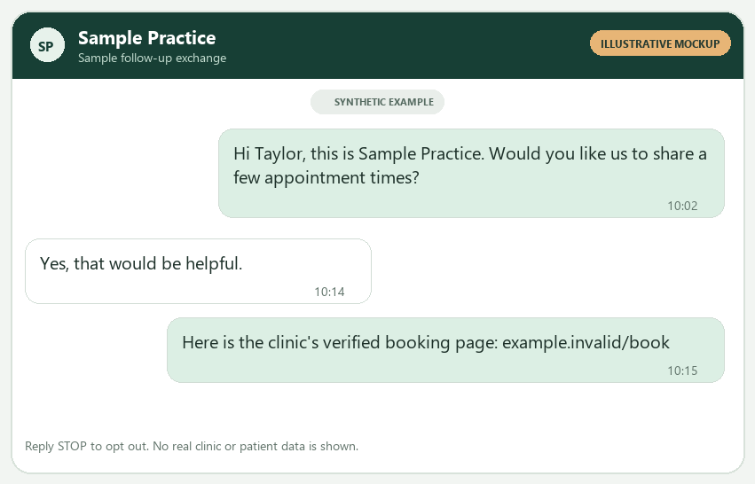

# Aurevia Practice OS

**A clinic follow-up and reactivation workspace for med spa, dermatology, and dental teams.**

Aurevia brings overdue follow-up, approved outreach, incoming replies, booking links, and staff review into one visible workflow. The aim is to help a practice team act on the right follow-up without losing context across spreadsheets, messages, and call logs.

> **Project status:** This repository contains a React/Vite application and n8n workflow templates. The current integration documentation uses Google Sheets. A VPS deployment with a production database is a future target, not a stack provisioned by this repository. Do not connect real patient data until the production, privacy, security, and compliance work described below is complete.

## What the product does

1. **Find follow-up gaps.** Review an audience that meets the clinic's configured reactivation criteria.
2. **Prepare approved outreach.** Use clinic-approved offers and booking links rather than inventing prices or availability.
3. **Keep conversations visible.** Track outreach, replies, booking intent, and handoffs in the practice workspace.
4. **Bring staff into the loop.** Route clinical or sensitive questions for human review; honor opt-outs and configured contact limits.
5. **See operational activity.** Review audience, outreach, bookings, and staff follow-up in the dashboard.

The product supports operational follow-up; it is not a clinical decision system and does not promise a specific number of bookings or revenue.

## Product preview

The dashboard screenshot uses the built-in synthetic preview dataset. It is not a live clinic account or evidence of production messaging.


The conversation illustrations below are presentation assets. They contain synthetic content and are labeled as mockups; they are not customer conversations.




## Who it is for

- Independent med spas and dermatology practices with an existing, permissioned client list.
- Private dental practices that want a clearer recall and follow-up process.
- Practice teams that can review sensitive replies and own their consent, messaging, and escalation policies.

The intended first step is a limited, staff-supervised clinic pilot using synthetic data, followed by a reviewed integration with the clinic's own systems.

## Current capabilities

- Practice overview, client list, conversations, offers, campaigns, missed-call recovery, and a human review queue.
- A synthetic preview mode for product walkthroughs without a live n8n connection.
- n8n workflow exports for inbound replies, outbound campaigns, missed calls, read endpoints, handoff updates, and error notifications.
- Google Sheets-oriented data contracts documented in [N8N_INTEGRATION.md](N8N_INTEGRATION.md).
- Configurable booking and messaging provider connection points. Provider credentials belong in n8n, not in the browser.
- A pricing page in the app with a setup-plus-subscription model. Messaging, provider usage, and infrastructure are shown as separate costs.

Pricing and pilot terms in the app are working product values, not a signed offer. Confirm the rates, scope, and any outcome-based terms before quoting them to a clinic.

## How it is built today

```text
Practice team
    |
    v
React + Vite workspace
    |
    v
n8n webhooks and workflow templates
    |
    +--> Google Sheets (current documented data source)
    +--> Messaging / calendar providers (configure separately)
```

The frontend is a static client application. The checked-in integration guides and n8n exports are Google Sheets-oriented; they are not a database adapter. There is no backend API service, VPS deployment configuration, database schema, or migration set included here.

### Intended VPS and database direction

The planned deployment can use a VPS and a production database, but that architecture still needs implementation and verification. Before using real clinic data, the project needs a selected database, server-side API/authentication, tenant isolation, migrations, backup and restore procedures, monitoring, and a security/privacy review. Do not put database credentials, provider secrets, or private bearer tokens in `VITE_*` variables: Vite embeds those values in browser assets.

If browser requests need authentication, put an authenticated server-side gateway or API between the browser and n8n. Keep Google, LLM, messaging, and database credentials in server-side secret storage.

## Run locally

Use the synthetic preview mode for development and demonstrations.

```bash
npm ci
```

Copy `.env.example` to `.env`, keep `VITE_DEMO_MODE=true`, and start the application:

```bash
npm run dev
```

Useful checks:

```bash
npm test
npm run build
node scripts/validate_workflows.js
node scripts/demo_missed_call.js
```

The workflow demo scripts do not activate n8n workflows or prove that a live provider is configured. For n8n setup and webhook examples, read [DEPLOYMENT.md](DEPLOYMENT.md) and [N8N_READ_API_IMPORT.md](N8N_READ_API_IMPORT.md).

## Before a live clinic pilot

This repository is not, by itself, a production-ready healthcare data environment. Complete and verify these items with the clinic and its qualified advisers:

- Replace the current Google Sheets template path with the selected production database, or explicitly approve a secured Sheets-based pilot.
- Add server-side authentication and authorization, tenant boundaries, secure secret management, and least-privilege provider access.
- Confirm consent, opt-out handling, retention, access logging, deletion, backups, and restore procedures.
- Review every message template, offer, booking link, quiet-hour rule, and escalation path with the practice.
- Complete vendor agreements and independent legal/privacy review for applicable healthcare, messaging, and consumer-protection requirements.
- Test with synthetic data first, then validate the exact production workflows and provider callbacks before enabling sends.

No HIPAA, TCPA, clinical, revenue, uptime, or booking outcome guarantee is made by this repository. A clinic must determine its own legal and regulatory obligations before any live use.

## Project structure

| Path | Purpose |
| --- | --- |
| `src/` | React application, pages, state, and integration clients |
| `test/` | Automated regression tests |
| `scripts/` | Workflow validation and local demo utilities |
| `*.json` workflow exports | n8n templates; credentials and clinic-specific spreadsheet IDs must be configured after import |
| `DEPLOYMENT.md` | Frontend, n8n, and pilot deployment notes |
| `N8N_INTEGRATION.md` | Webhook payloads, response shapes, and current Sheets-oriented schema |
| `N8N_READ_API_IMPORT.md` | Read-workflow import and verification steps |

## License and use

No license file is currently included. Until a license is added, do not assume the source is licensed for redistribution or commercial reuse. The README and screenshots describe the project; they do not replace implementation, security, privacy, or legal review.
