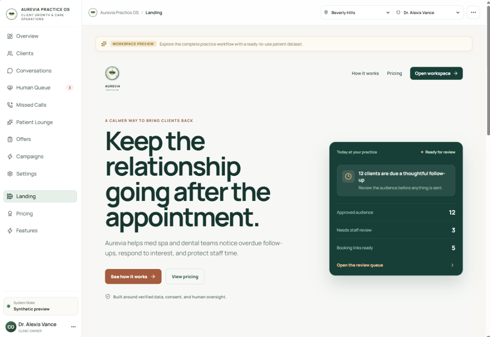
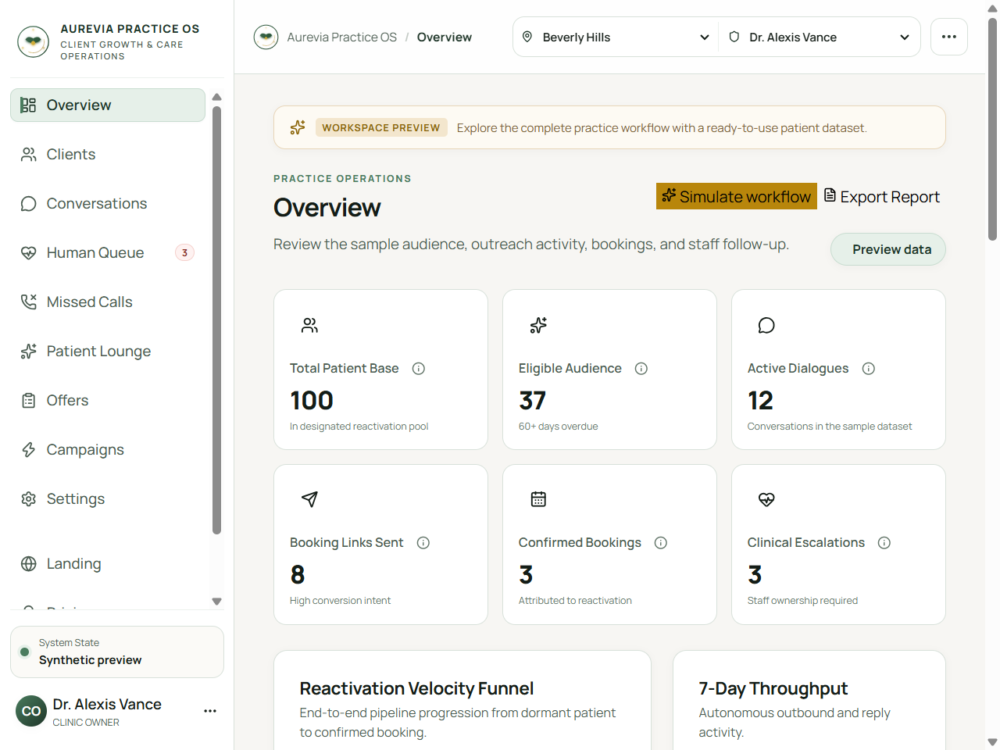
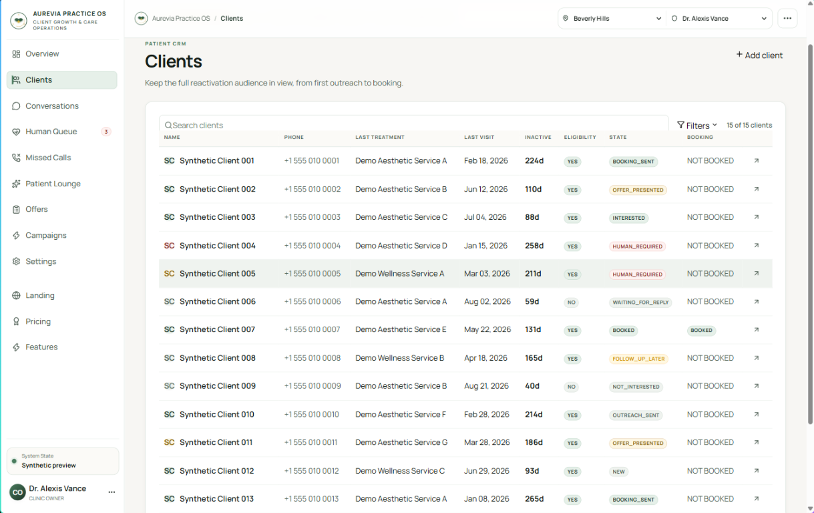
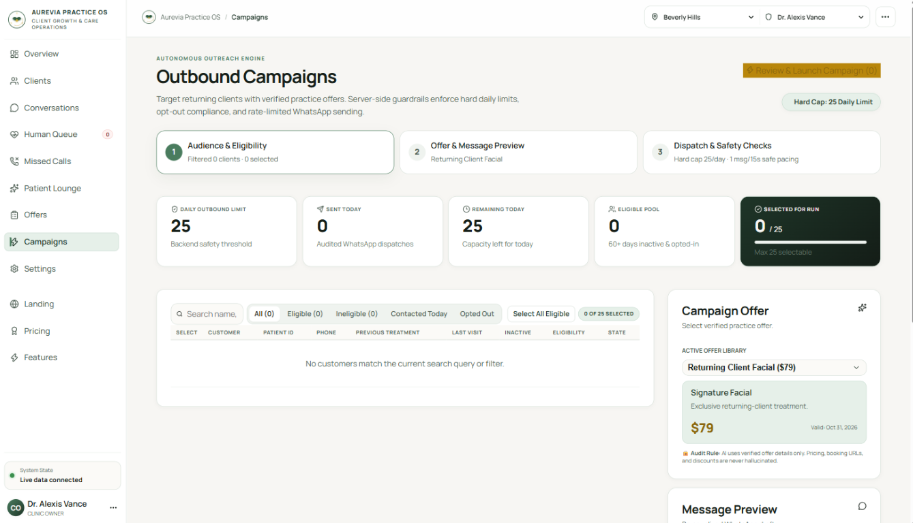
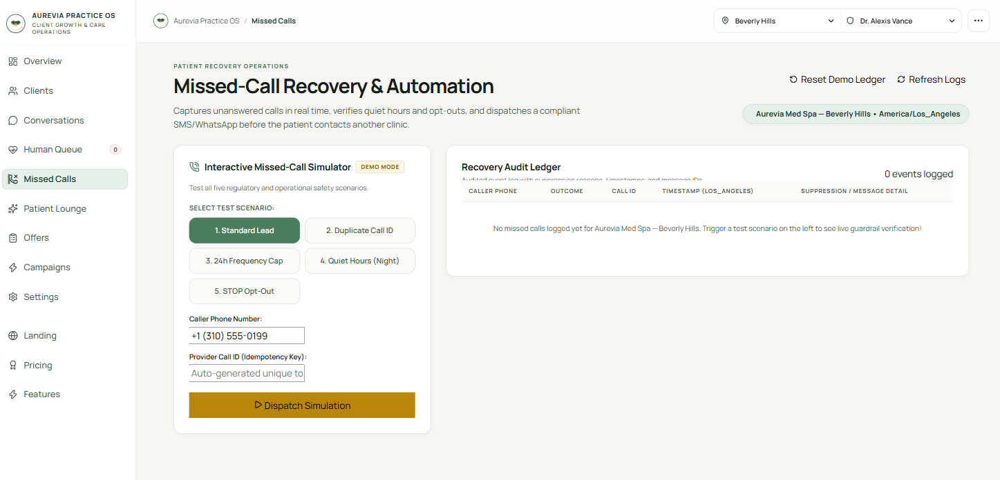
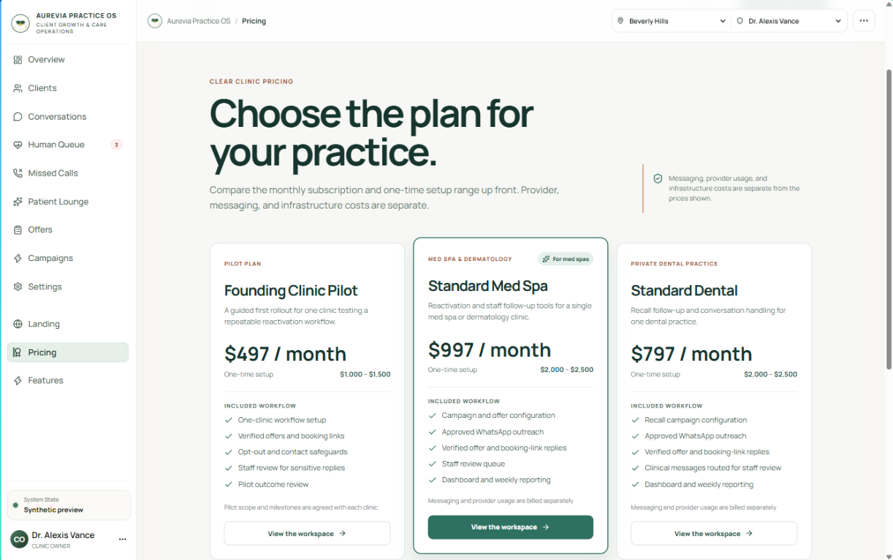
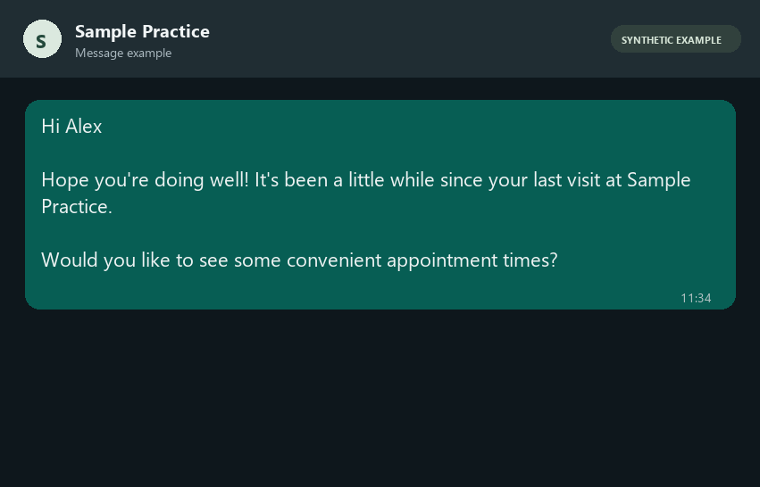
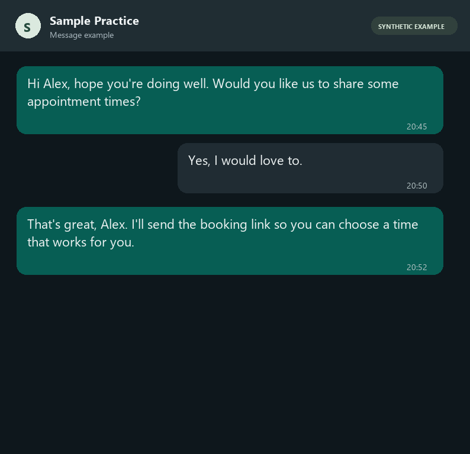
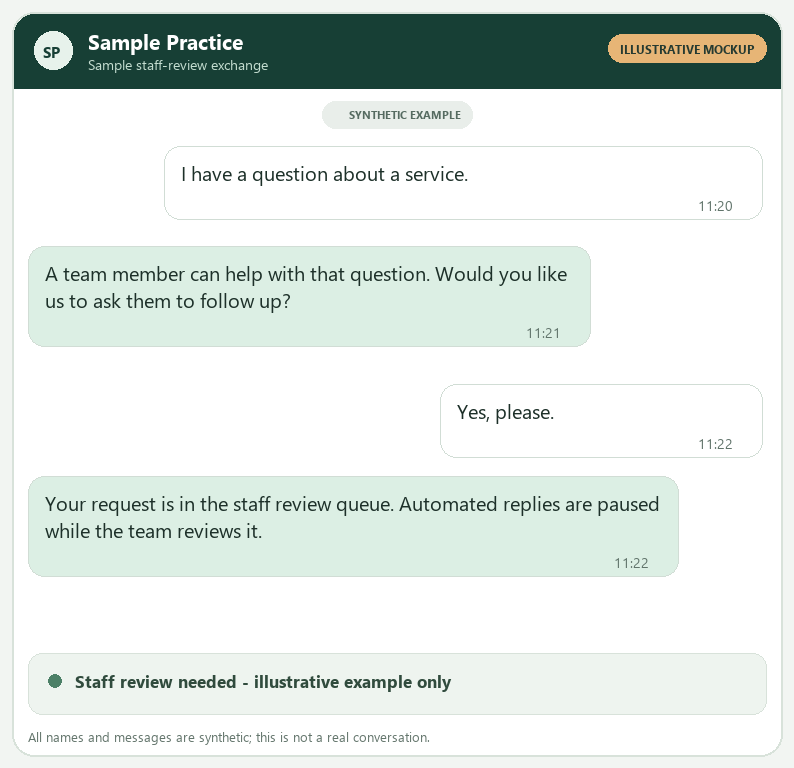
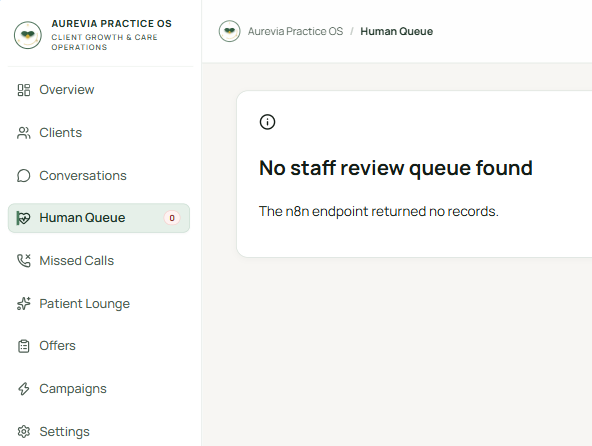

# Aurevia Practice OS

**Patient follow-up, messaging, and staff review in one workspace.**

Aurevia is for med spa, dermatology, and dental teams that want a clearer way to follow up with clients. It brings the client list, campaigns, replies, missed calls, and staff handoffs together.

> **Current state:** This repository contains a React/Vite app and n8n workflow templates. The documented data source is Google Sheets. A VPS and production database are planned, but are not included here. Use the synthetic preview until a production data path and its safeguards are in place.

## The workflow

1. **Review who is due.** Check the client list and the configured eligibility rules.
2. **Prepare a follow-up.** Select an approved offer and message before launching a campaign.
3. **Handle the reply.** Keep booking interest visible, honor opt-outs, and send clinical or sensitive questions to staff.
4. **Recover missed calls.** Check quiet hours and contact rules before a configured text-back.

The app helps coordinate practice operations. It does not provide clinical advice or guarantee bookings.

## Screens from the app

These are screenshots of the current interface. The app preview uses sample records; live-connected screens may show empty results. They are not evidence of production messaging or customer outcomes.
Each image is kept at its original pixel size and will scale down to fit a smaller screen.

### Landing page

<p></p>

### Practice overview

<p></p>

### Client list and campaigns

<p></p>

<p></p>

### Missed-call recovery

<p></p>

### Pricing

The prices below are the values currently shown in the app. Confirm scope and rates before presenting them as an offer.

<p></p>

### Messages and staff review

The chat examples follow the supplied message thread, with the name, practice, and treatment details replaced. The staff-review example is retained. None shows a real patient conversation.

<p></p>

<p></p>

<p></p>

<p></p>

## What is included

- React/Vite workspace for overview, clients, conversations, campaigns, missed calls, offers, and staff review.
- Synthetic preview data for local walkthroughs.
- n8n workflow exports for inbound replies, outbound campaigns, missed calls, read endpoints, handoffs, and error notifications.
- Google Sheets-oriented webhook and data contracts.
- Configurable booking and messaging provider connection points; provider credentials stay server-side.

See [N8N_INTEGRATION.md](N8N_INTEGRATION.md) for the current webhook contracts and [N8N_READ_API_IMPORT.md](N8N_READ_API_IMPORT.md) for importing read workflows.

## Run locally

Install dependencies, copy `.env.example` to `.env`, leave `VITE_DEMO_MODE=true`, then start the app:

```bash
npm ci
npm run dev
```

Run the checks:

```bash
npm test
npm run build
node scripts/validate_workflows.js
```

For n8n configuration notes and webhook examples, see [DEPLOYMENT.md](DEPLOYMENT.md). Static workflow validation does not test a live n8n instance or provider.

## Before using real clinic data

The planned VPS/database deployment needs more than a static frontend and workflow exports. Choose and implement the database, server-side API and authentication, tenant separation, secret storage, backups, and monitoring. Review consent, retention, access, messaging rules, and vendor agreements with the clinic and its qualified advisers before enabling live outreach.

All `VITE_*` settings are visible in browser assets. Do not put database passwords, provider credentials, or private bearer tokens in them. The current workflow templates use Google Sheets; they are not a production database adapter.

No HIPAA, TCPA, clinical, revenue, uptime, or booking guarantee is made by this repository.

## License

There is no license file in this repository. Do not assume the source is licensed for redistribution or commercial reuse.
